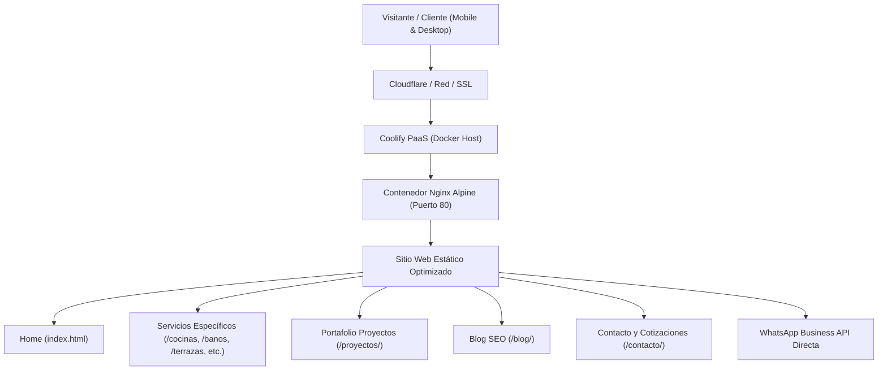

# Mapa Conceptual: SOLE – Soluciones Originales para Lugares y Espacios

## 1. Propósito y Filosofía del Proyecto
**SOLE** es una plataforma web comercial, técnica y altamente orientada a posicionamiento orgánico (SEO) para una empresa de planificación, gestión integral y ejecución de obras de construcción, remodelaciones y habilitación de espacios en Santiago de Chile.

A diferencia de un servicio informal de mano de obra o maestros independientes, SOLE proyecta una imagen de:
- **Gestión integral (Llave en mano):** El cliente delega análisis, levantamiento, compras, mano de obra, supervisión y entrega final.
- **Tranquilidad y orden:** Sin sobrecostos imprevistos, con calendarización y acompañamiento constante.
- **Estética de alto nivel:** Arquitectura, diseño contemporáneo e interiorismo cálido (paleta azul petróleo `#294F68`, azul cielo `#5BAED1`, dorado suave `#F6CC78` y blanco cálido `#FAF8F2`).

---

## 2. Arquitectura General y Tecnologías

- **Stack Tecnológico:**
  - **Estructura:** HTML5 semántico nativo (sin frameworks pesados para máxima velocidad y Lighthouse 100).
  - **Estilos:** CSS3 puro con variables corporativas (`--color-primary`, `--color-secondary`, etc.) y responsive design Mobile First + widescreen horizontal layout.
  - **Interactividad:** JavaScript modular (`js/main.js`) con variables centralizadas (`SOLE_CONFIG`), control de FAQ acordeón, menú responsive y ganchos para Google Analytics 4, GTM y Meta Pixel.
  - **Servidor y Producción:** `Dockerfile` con `nginx:alpine` y `nginx.conf` optimizado con compresión Gzip y headers de caché para assets.
  - **SEO Técnico:** `sitemap.xml`, `robots.txt`, Schema.org JSON-LD (`HomeAndConstructionBusiness`, `Service`, `Article`, `AboutPage`, `ContactPage`), canonical tags y metadatos Open Graph.

---

## 3. Arquitectura de URLs y Contenidos

| Ruta | Propósito | Intención de Búsqueda |
| :--- | :--- | :--- |
| `/` | Landing Home principal con Hero idéntico a referencia, servicios rápidos, proyectos destacados, modalidades y formulario | Comercial / Transaccional |
| `/nosotros/` | Historia, filosofía de gestión integral y pilares de confianza | Corporativa / Confianza |
| `/servicios/` | Catálogo de especialidades arquitectónicas | Comercial |
| `/construccion/` | Obras nuevas, ampliaciones y estructuras | Comercial / Local |
| `/remodelaciones/` | Remodelación integral de casas y departamentos | Comercial / Local |
| `/remodelacion-de-cocinas/` | Muebles a medida, cubiertas de cuarzo y diseño ergonómico | Transaccional / Comercial |
| `/remodelacion-de-banos/` | Shower doors, vanitorios suspendidos y porcelanatos | Transaccional / Comercial |
| `/areas-verdes/` | Paisajismo residencial y senderos de piedra | Comercial |
| `/terrazas/` | Pérgolas de madera y metal, decks y cubiertas para todo el año | Transaccional / Comercial |
| `/cobertizos-y-quinchos/` | Quinchos con parrilla de acero, barras y cobertizos | Transaccional / Comercial |
| `/proyectos/` | Galería detallada de casos con fichas técnicas | Inspiracional / Prueba social |
| `/contacto/` | Formulario, WhatsApp, ubicación y horarios de atención | Transaccional |
| `/blog/` | Centro de contenidos y guías prácticas para clientes | Informativa / Long-tail SEO |
| `/blog/cuanto-cuesta-remodelar-una-cocina/` | Guía de precios y partidas presupuestarias | Informativa / Decisión |
| `/blog/que-incluye-una-remodelacion-integral/` | Explicación detallada de delegar vs contratar maestros | Informativa / Comercial |
| `/blog/como-planificar-una-remodelacion/` | Metodología de pasos para remodelar sin errores | Informativa |

---

## 4. Modalidades de Negocio y Reglas Clave

1. **Modalidad Principal: Proyecto Integral ("Nosotros gestionamos todo")**
   - Centraliza levantamiento, cubicación, materiales, especialistas, cronograma, supervisión y entrega.
   - Es el foco de rentabilidad y propuesta de valor de la marca SOLE.
2. **Modalidad Secundaria: Mano de Obra**
   - El cliente aporta materiales y SOLE ejecuta con herramientas y control de calidad.
3. **Esquema de Pago Transparente:**
   - 50% al iniciar las faenas y compra de insumos.
   - 50% a la entrega y recepción conforme de la obra.
4. **Variables de Negocio Centralizadas:**
   - Teléfono, WhatsApp, correo, ciudad y horario editables desde `js/main.js` (`SOLE_CONFIG`).
